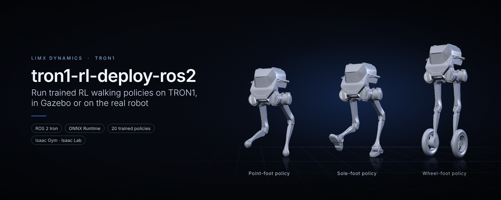
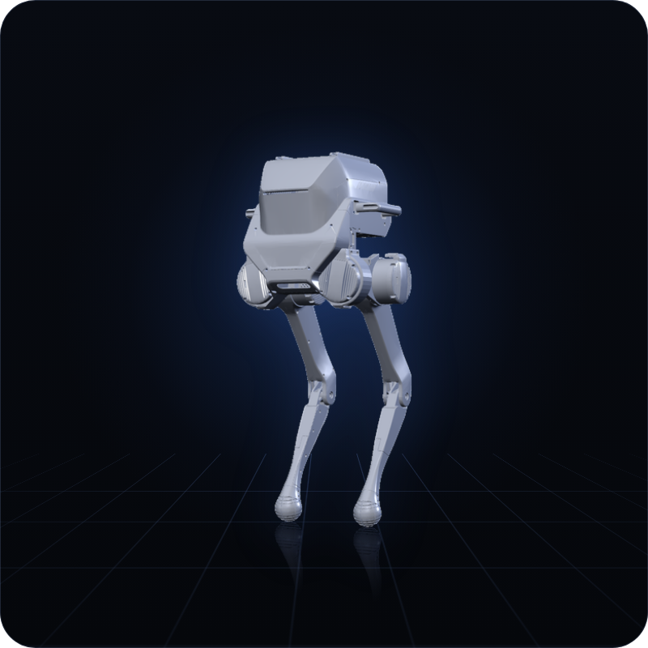
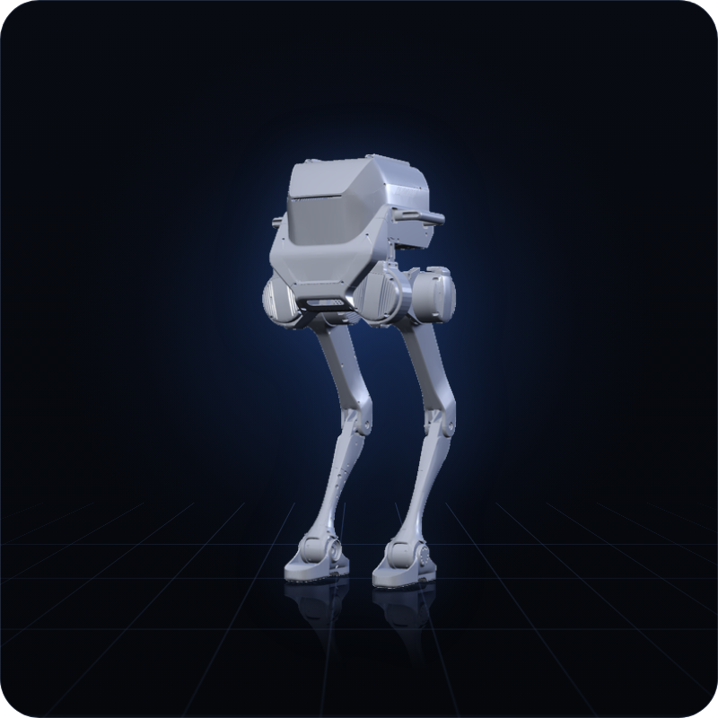
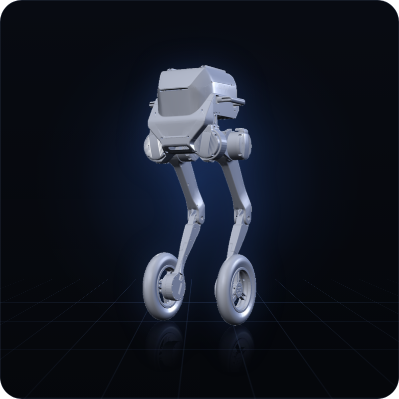
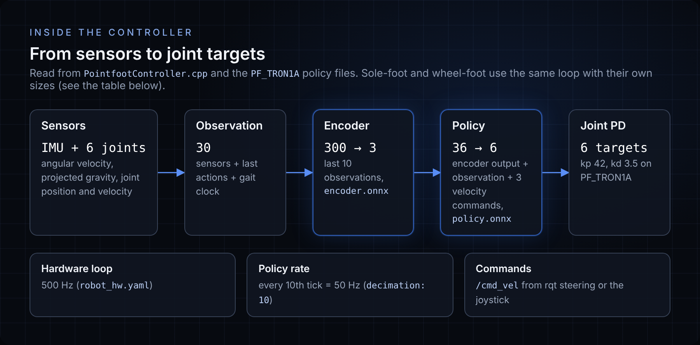

<p align="center">
  
</p>

<p align="center">
  <b>English</b> | <a href="README_cn.md">中文</a>
</p>

<p align="center">
  <a href="LICENSE"></a>
  
  
  
  <a href="https://github.com/limxdynamics/limxdynamics/blob/main/doc/wechat_qr.png"></a>
</p>
<p align="center"><sub>For partnership and procurement inquiries, contact <a href="mailto:opensource@limxdynamics.com">opensource@limxdynamics.com</a></sub></p>

# Deployment of Training Results

> **Part of the TRON1 open-source ecosystem.** Where to start and the other TRON1 repositories: [TRON1 quick start](https://github.com/limxdynamics/limxdynamics/blob/main/doc/quickstart.md#tron1).

**Run trained RL walking policies on the LimX TRON1 with ROS 2**, in Gazebo or on the real robot. `ros2_control` controllers load ONNX policies and turn velocity commands into joint targets.

## Highlights

- **Trained policies included.** 20 ready-to-run ONNX policy pairs ship in the repository: 10 robot types, each trained in both Isaac Gym and Isaac Lab.
- **Every TRON1 foot type.** Separate controllers for point-foot, sole-foot and wheel-foot, selected automatically from `ROBOT_TYPE`.
- **Same controller in sim and on the robot.** `pointfoot_hw_sim.launch.py` drives [`tron1-gazebo-ros2`](https://github.com/limxdynamics/tron1-gazebo-ros2); `pointfoot_hw.launch.py` connects the same controller to the robot at `10.192.1.2`.
- **Bring your own policy.** Replace `encoder.onnx` and `policy.onnx` under `robot_controllers/config/pointfoot/<ROBOT_TYPE>/policy/<RL_TYPE>/` with ones trained in [`tron1-rl-isaacgym`](https://github.com/limxdynamics/tron1-rl-isaacgym) or [`tron1-rl-isaaclab`](https://github.com/limxdynamics/tron1-rl-isaaclab).
- **Three ROS 2 distributions.** `main` targets Iron; the [`feature/humble`](https://github.com/limxdynamics/tron1-rl-deploy-ros2/tree/feature/humble) and [`feature/foxy`](https://github.com/limxdynamics/tron1-rl-deploy-ros2/tree/feature/foxy) branches cover Humble and Foxy.

## Included policies

| | Controller | Robot types | Encoder (in → out) | Policy (in → out) |
| :-: | --- | --- | --- | --- |
|  | **Point foot**<br>`PointfootController` | `PF_TRON1A` `PF_TRON1B` `PF_P441A` `PF_P441B` `PF_P441C` `PF_P441C2` | 300 → 3 | 36 → 6 |
|  | **Sole foot**<br>`SolefootController` | `SF_TRON1A` `SF_TRON1B` | Isaac Gym 180 → 3<br>Isaac Lab 360 → 3 | Isaac Gym 44 → 8<br>Isaac Lab 42 → 8 |
|  | **Wheel foot**<br>`WheelfootController` | `WF_TRON1A` `WF_TRON1B` | 280 → 3 | 34 → 8 |

Every robot type has both an `isaacgym` and an `isaaclab` policy. Sizes were read from the ONNX files with ONNX Runtime; all 20 pairs load.

## How it works

<p align="center">
  
</p>

## Launch files

| Launch file | Connects to | Starts the controller |
| --- | --- | --- |
| `ros2 launch robot_hw pointfoot_hw_sim.launch.py` | Gazebo from `tron1-gazebo-ros2` (`127.0.0.1`) | Automatically, about 6 s after launch |
| `ros2 launch robot_hw pointfoot_hw.launch.py` | Real robot at `10.192.1.2` | Joystick `L1` + `Y` (`L1` + `X` stops it) |

Velocity commands are read from `/cmd_vel`, for example from rqt robot steering.

## Set up and run

### 1. Deployment Environment Configuration

- Install ROS 2 Iron: Set up a ROS 2 Iron-based algorithm Development Environment on the Ubuntu 22.04 operating system. For installation, please refer to the documentation: https://docs.ros.org/en/iron/Installation/Ubuntu-Install-Debians.html, and choose "ros-iron-desktop" for installation. After the installation of ROS 2 Iron is completed, enter the following Shell commands in the Bash end point to install the libraries required by the Development Environment:

    ```bash
    sudo apt update
    sudo apt install ros-iron-urdf \
                ros-iron-urdfdom \
                ros-iron-urdfdom-headers \
                ros-iron-kdl-parser \
                ros-iron-hardware-interface \
                ros-iron-controller-manager \
                ros-iron-controller-interface \
                ros-iron-controller-manager-msgs \
                ros-iron-control-msgs \
                ros-iron-controller-interface \
                ros-iron-gazebo-* \
                ros-iron-rviz* \
                ros-iron-rqt-gui \
                ros-iron-rqt-robot-steering \
                ros-iron-plotjuggler* \
                ros-iron-control-toolbox \
                ros-iron-ros2-control \
                ros-iron-ros2-controllers \
                ros-dev-tools \
                cmake build-essential libpcl-dev libeigen3-dev libopencv-dev libmatio-dev \
                python3-pip libboost-all-dev libtbb-dev liburdfdom-dev liborocos-kdl-dev -y
    ```

- Install the onnxruntime dependency, download link: https://github.com/microsoft/onnxruntime/releases/tag/v1.10.0. Please choose the appropriate version to download according to your operating system and platform. For example, on Ubuntu 22.04 x86_64, please follow the steps below for installation:

    ```bash
    wget https://github.com/microsoft/onnxruntime/releases/download/v1.10.0/onnxruntime-linux-x64-1.10.0.tgz

    tar xvf onnxruntime-linux-x64-1.10.0.tgz

    sudo cp -a onnxruntime-linux-x64-1.10.0/include/* /usr/include
    sudo cp -a onnxruntime-linux-x64-1.10.0/lib/* /usr/lib
    ```

### 2. Create Workspace

You can create an RL deployment development workspace by following these steps:
- Open a Bash end point.
- Create a new directory to store the workspace. For example, you can create a directory named "limx_ws" under the user's home directory:
    ```bash
    mkdir -p ~/limx_ws/src
    ```

- Download the Motion Control Development Interface:
    ```bash
    cd ~/limx_ws/src
    git clone https://github.com/limxdynamics/limxsdk-lowlevel.git
    ```

- Download Gazebo Simulator:
    ```bash
    cd ~/limx_ws/src
    git clone https://github.com/limxdynamics/tron1-gazebo-ros2.git
    ```

- Download the robot model description file
    ```bash
    cd ~/limx_ws/src
    git clone https://github.com/limxdynamics/tron1-robot-description.git robot-description
    ```

- Download Visualization Tool
    ```bash
    cd ~/limx_ws/src
    git clone https://github.com/limxdynamics/robot-visualization.git
    ```

- Download RL deployment source code:
    ```bash
    cd ~/limx_ws/src
    git clone https://github.com/limxdynamics/tron1-rl-deploy-ros2.git
    ```

- Compile Project:
    ```bash
    cd ~/limx_ws
    source /opt/ros/iron/setup.bash
    colcon build --cmake-args -DCMAKE_BUILD_TYPE=Release
    ```

- Select robot type

  - List available robot types via the Shell command `tree -L 1 src/robot-description/pointfoot`:

    ```
    src/robot-description/pointfoot
    ├── PF_P441A
    ├── PF_P441B
    ├── PF_P441C
    ├── PF_P441C2
    ├── PF_TRON1A
    ├── PF_TRON1B
    ├── SF_TRON1A
    ├── SF_TRON1B
    ├── WF_TRON1A
    └── WF_TRON1B
    ```

  - Taking `PF_P441C` (please replace it according to the actual robot type) as an example, set the robot model type:

    ```bash
    echo 'export ROBOT_TYPE=PF_P441C' >> ~/.bashrc && source ~/.bashrc
    ```

- Select training environment

  The currently supported training environments are isaacgym and isaaclab. Taking isaacgym as an example, set the training environment type:

  ```bash
  echo 'export RL_TYPE=isaacgym' >> ~/.bashrc && source ~/.bashrc
  ```

- Run Simulation

  ```bash
  source /opt/ros/iron/setup.bash
  source install/setup.bash
  ros2 launch robot_hw pointfoot_hw_sim.launch.py
  ```
  

## License

See [LICENSE](LICENSE).
