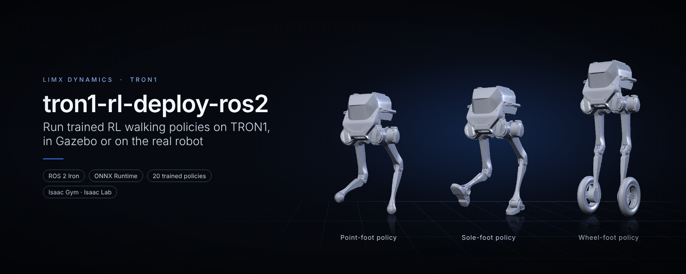
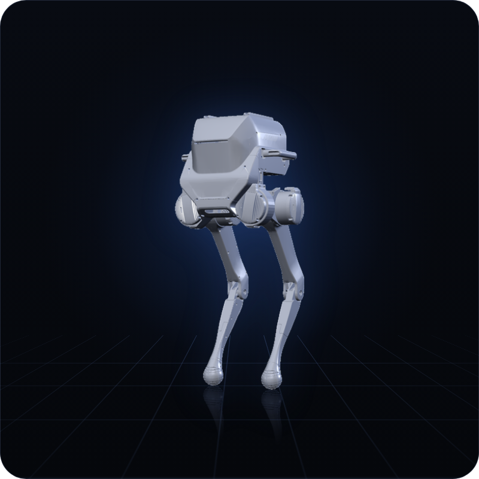
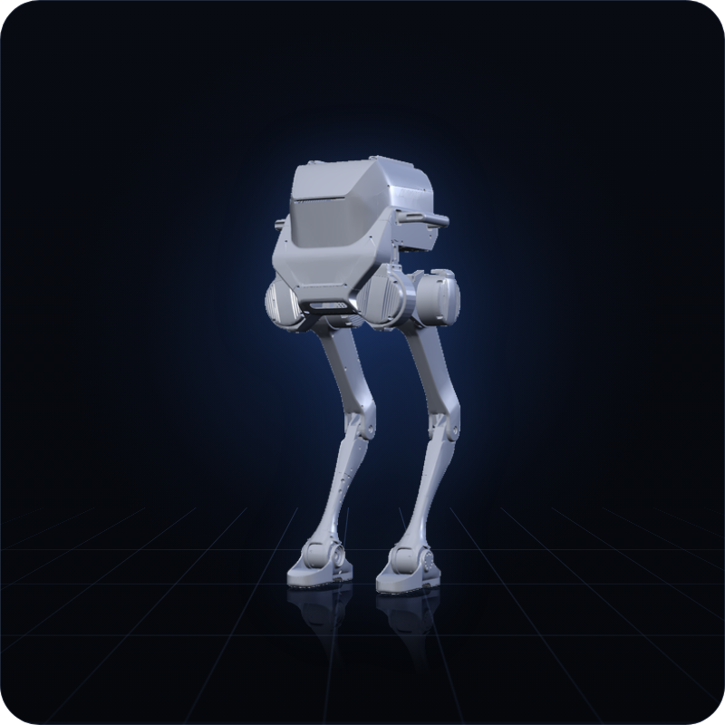
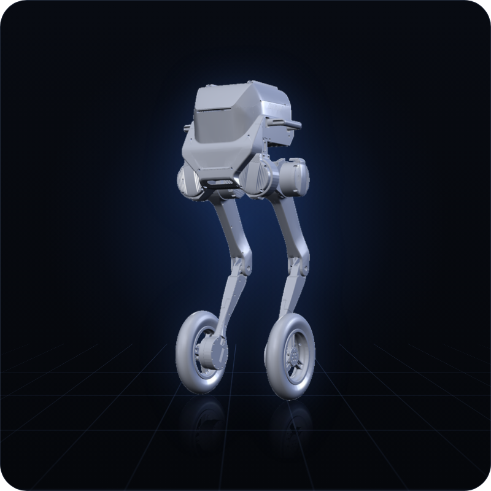
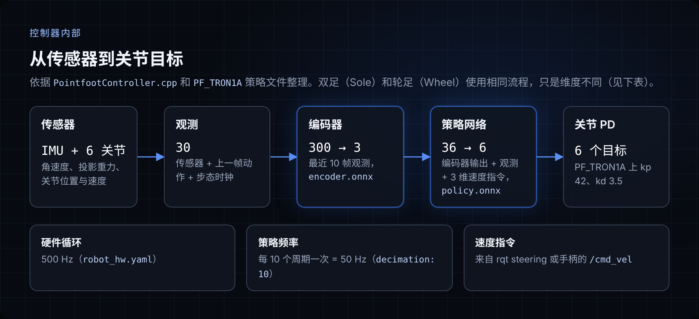

<p align="center">
  
</p>

<p align="center">
  <a href="README.md">English</a> | <b>中文</b>
</p>

<p align="center">
  <a href="LICENSE"></a>
  
  
  
  <a href="https://github.com/limxdynamics/limxdynamics/blob/main/doc/wechat_qr.png"></a>
</p>
<p align="center"><sub>合作采购请联系 <a href="mailto:opensource@limxdynamics.com">opensource@limxdynamics.com</a></sub></p>

# 训练结果部署

> **TRON1 开源生态的一部分。** 上手路线和其他 TRON1 仓库：[TRON1 快速上手](https://github.com/limxdynamics/limxdynamics/blob/main/doc/quickstart_cn.md#tron1)。

**用 ROS 2 在 LimX TRON1 上运行训练好的 RL 行走策略**，Gazebo 仿真和真机都可以。`ros2_control` 控制器加载 ONNX 策略，把速度指令转换为关节目标。

## 亮点

- **自带训练好的策略。** 仓库内含 20 组可直接运行的 ONNX 策略：10 个机器人型号，每个型号都有 Isaac Gym 和 Isaac Lab 两个版本。
- **覆盖 TRON1 全部足型。** 点足、双足（带踝）、轮足各有独立控制器，根据 `ROBOT_TYPE` 自动选择。
- **仿真与真机同一个控制器。** `pointfoot_hw_sim.launch.py` 驱动 [`tron1-gazebo-ros2`](https://github.com/limxdynamics/tron1-gazebo-ros2) 仿真；`pointfoot_hw.launch.py` 让同一个控制器连接 `10.192.1.2` 上的真机。
- **可替换为自己的策略。** 把在 [`tron1-rl-isaacgym`](https://github.com/limxdynamics/tron1-rl-isaacgym) 或 [`tron1-rl-isaaclab`](https://github.com/limxdynamics/tron1-rl-isaaclab) 中训练的 `encoder.onnx` 和 `policy.onnx` 放到 `robot_controllers/config/pointfoot/<ROBOT_TYPE>/policy/<RL_TYPE>/` 下即可。
- **支持三个 ROS 2 发行版。** `main` 分支对应 Iron；[`feature/humble`](https://github.com/limxdynamics/tron1-rl-deploy-ros2/tree/feature/humble) 与 [`feature/foxy`](https://github.com/limxdynamics/tron1-rl-deploy-ros2/tree/feature/foxy) 分支分别对应 Humble 和 Foxy。

## 内置策略

| | 控制器 | 机器人型号 | 编码器（输入 → 输出） | 策略网络（输入 → 输出） |
| :-: | --- | --- | --- | --- |
|  | **点足**<br>`PointfootController` | `PF_TRON1A` `PF_TRON1B` `PF_P441A` `PF_P441B` `PF_P441C` `PF_P441C2` | 300 → 3 | 36 → 6 |
|  | **双足（Sole）**<br>`SolefootController` | `SF_TRON1A` `SF_TRON1B` | Isaac Gym 180 → 3<br>Isaac Lab 360 → 3 | Isaac Gym 44 → 8<br>Isaac Lab 42 → 8 |
|  | **轮足**<br>`WheelfootController` | `WF_TRON1A` `WF_TRON1B` | 280 → 3 | 34 → 8 |

每个型号都同时提供 `isaacgym` 和 `isaaclab` 策略。维度用 ONNX Runtime 从模型文件中读取，20 组全部可以加载。

## 工作原理

<p align="center">
  
</p>

## 启动文件

| 启动文件 | 连接对象 | 控制器如何启动 |
| --- | --- | --- |
| `ros2 launch robot_hw pointfoot_hw_sim.launch.py` | `tron1-gazebo-ros2` 的 Gazebo 仿真（`127.0.0.1`） | 启动约 6 秒后自动开始 |
| `ros2 launch robot_hw pointfoot_hw.launch.py` | `10.192.1.2` 上的真机 | 手柄 `L1` + `Y`（`L1` + `X` 停止） |

速度指令从 `/cmd_vel` 读取，例如来自 rqt robot steering。

## 安装与运行

### 1. 部署环境配置

- 安装ROS 2 Iron：在 Ubuntu 22.04 操作系统上建立基于 ROS 2 Iron 的算法开发环境。 安装请参考文档： https://docs.ros.org/en/iron/Installation/Ubuntu-Install-Debians.html ，选择“ros-iron-desktop”进行安装。ROS 2 Iron 安装完成后，Bash 终端输入以下 Shell 命令，安装开发环境所依赖的库：

    ```bash
    sudo apt update
    sudo apt install ros-iron-urdf \
                ros-iron-urdfdom \
                ros-iron-urdfdom-headers \
                ros-iron-kdl-parser \
                ros-iron-hardware-interface \
                ros-iron-controller-manager \
                ros-iron-controller-interface \
                ros-iron-controller-manager-msgs \
                ros-iron-control-msgs \
                ros-iron-controller-interface \
                ros-iron-gazebo-* \
                ros-iron-rviz* \
                ros-iron-rqt-gui \
                ros-iron-rqt-robot-steering \
                ros-iron-plotjuggler* \
                ros-iron-control-toolbox \
                ros-iron-ros2-control \
                ros-iron-ros2-controllers \
                ros-dev-tools \
                cmake build-essential libpcl-dev libeigen3-dev libopencv-dev libmatio-dev \
                python3-pip libboost-all-dev libtbb-dev liburdfdom-dev liborocos-kdl-dev -y
    ```

- 安装onnxruntime依赖，下载连接：https://github.com/microsoft/onnxruntime/releases/tag/v1.10.0 。请您根据自己的操作系统和平台选择合适版本下载。如在Ubuntu 22.04 x86_64，请按下面步骤进行安装：

    ```bash
    wget https://github.com/microsoft/onnxruntime/releases/download/v1.10.0/onnxruntime-linux-x64-1.10.0.tgz

    tar xvf onnxruntime-linux-x64-1.10.0.tgz

    sudo cp -a onnxruntime-linux-x64-1.10.0/include/* /usr/include
    sudo cp -a onnxruntime-linux-x64-1.10.0/lib/* /usr/lib
    ```

### 2. 创建工作空间

可以按照以下步骤，创建一个RL部署开发工作空间：

- 打开一个Bash终端。

- 创建一个新目录来存放工作空间。例如，可以在用户的主目录下创建一个名为“limx_ws”的目录：
    ```bash
    mkdir -p ~/limx_ws/src
    ```

- 下载机器人模型描述文件
    ```bash
    cd ~/limx_ws/src
    git clone https://github.com/limxdynamics/tron1-robot-description.git robot-description
    ```

- 下载运动控制开发接口：

    ```bash
    cd ~/limx_ws/src
    git clone https://github.com/limxdynamics/limxsdk-lowlevel.git
    ```

- 下载可视化工具
    ```bash
    cd ~/limx_ws/src
    git clone https://github.com/limxdynamics/robot-visualization.git
    ```

- 下载Gazebo仿真器：
    ```bash
    cd ~/limx_ws/src
    git clone https://github.com/limxdynamics/tron1-gazebo-ros2.git
    ```

- 下载RL部署源码：
    ```bash
    cd ~/limx_ws/src
    git clone https://github.com/limxdynamics/tron1-rl-deploy-ros2.git
    ```

- 编译工程：
    ```bash
    cd ~/limx_ws
    source /opt/ros/iron/setup.bash
    colcon build --cmake-args -DCMAKE_BUILD_TYPE=Release
    ```

- 选择机器人类型

  - 通过 Shell 命令 `tree -L 1 src/robot-description/pointfoot` 列出可用的机器人类型：

    ```
    src/robot-description/pointfoot
    ├── PF_P441A
    ├── PF_P441B
    ├── PF_P441C
    ├── PF_P441C2
    ├── PF_TRON1A
    ├── PF_TRON1B
    ├── SF_TRON1A
    ├── SF_TRON1B
    ├── WF_TRON1A
    └── WF_TRON1B
    ```

  - 以`PF_P441C`（请根据实际机器人类型进行替换）为例，设置机器人型号类型：

    ```bash
    echo 'export ROBOT_TYPE=PF_P441C' >> ~/.bashrc && source ~/.bashrc
    ```

- 选择训练环境

  目前支持的训练环境有`isaacgym`和`isaaclab`，以`isaacgym`为例，设置训练环境类型

  ```bash
  echo 'export RL_TYPE=isaacgym' >> ~/.bashrc && source ~/.bashrc
  ```

- 运行仿真

  ```bash
  source /opt/ros/iron/setup.bash
  source install/setup.bash
  ros2 launch robot_hw pointfoot_hw_sim.launch.py
  ```
  

## 许可证

见 [LICENSE](LICENSE)。
